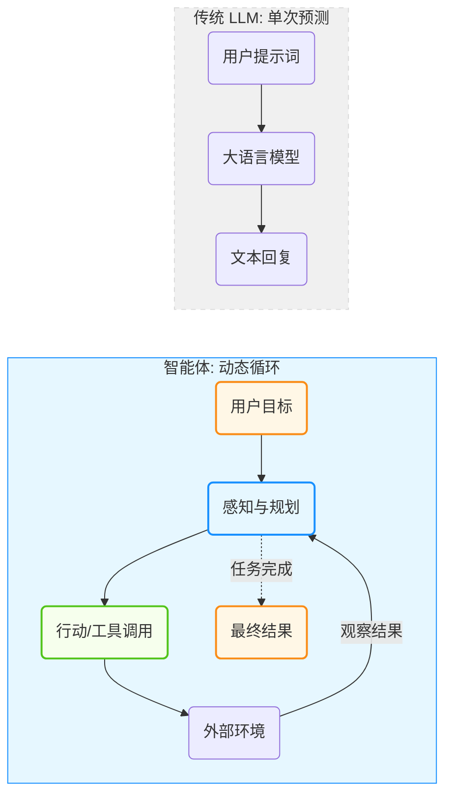

## 1.1 从大模型到智能体

本节介绍从 **生成式 AI** 到 **智能体 AI** 的演进，并分析二者的核心差异：从“下一个 Token 预测”转向以“目标达成”为导向。

### 1.1.1 从生成式 AI 到智能体 AI

人工智能正在从“生成式 AI (Generative AI)”转向“智能体 AI (Agentic AI)”。“聊天机器人”让大众看到了大模型的对话能力，“智能体”强调的则是能够独立完成任务的 **工作助手**。

传统的大语言模型（LLM）像一位博学的思想家：它读过互联网上的海量文本，拥有关于莎士比亚、量子物理和计算机编程的广博知识。但如果不给它工具、执行环境和状态管理，即便是能理解图像、生成语音的多模态模型，也依然主要停留在“输入-输出”范式里。它能“看”能“说”，但未必能稳定地“做”。

**智能体 AI** 赋予 LLM “手”（工具）、“眼”（感知）和“记忆”，把这位思想家变成能够与物理和数字世界互动的实干家。这一范式转移（Paradigm Shift）改变了人机交互的方式：人不再命令机器“生成一段文字”，而是授权机器“帮我达成一个目标”。

图 1-1：传统 LLM 与智能体架构对比

### 1.1.2 核心差异：从“下一个 Token 预测”到“目标达成”

智能体与 LLM 的区别体现在以下四个方面。

#### 目标导向与概率预测

LLM 的训练目标极其单一：根据上文预测下一个词元（Token）的概率分布。用户问它“这种药怎么吃？”，它给出说明书式的回答，只是因为训练数据中这类问题通常伴随这类回答，与治好病无关。

**智能体** 则是 **目标导向** 的。它内置一条核心指令（系统提示词）：“你是一个能够解决问题的助手”。面对任务时，它不急于输出词元 (Token)，而是先思考“为了达成这个目标，我需要获取什么信息？需要执行什么步骤？”。

#### 有状态与无状态

原生的 LLM 是无状态的函数：每一次请求对它来说都是全新的，它不记得上一秒发生了什么（除非把历史对话作为上下文传给它）。

智能体（Agent）维护着持久化的 **状态**，包括：

* **长期记忆**：记得你上周提到的过敏源。
* **任务状态**：知道“订机票”的任务目前停留在“已搜索航班，等待用户确认”的阶段。
* **环境状态**：知道当前目录下有哪些文件被创建了。

#### 主动循环与单次推理

这是最显著的架构差异。LLM 是输入 A -> 输出 B，线性且一次性。智能体则是处理（目标）-> 思考 -> 行动 -> 观察 -> 思考 -> ... -> 最终结果，构成一个 **循环（Loop）**：它在一个 `while` 循环中不断运行，直到认为任务完成或达到最大尝试次数。这种“试错-修正”的能力，使智能体有可能解决复杂的非线性问题。

#### 不确定的判断与确定的执行

前面三点差异归结起来是：LLM 的输出只是文本，读的人可以不信；智能体的输出会被执行。因此智能体由两部分组成。一部分是 **确定的**：工具代码、权限检查、状态存储、循环控制，给定输入就有确定的结果。另一部分是 **不确定的**：模型对意图的理解、对步骤的规划、对工具和参数的选择，事先无法枚举，同样的输入也可能得到不同的结果。

传统软件只有第一部分，行为都由开发者预先写定，能处理的也只限于开发者想到的情况。智能体的能力恰恰来自第二部分：面对没人写过规则的请求，它也能给出合理的下一步。但同一个性质也带来风险，模型给出的下一步可能是错的，原因有两类：

* **自己出错**：幻觉、误解意图、规划跑偏。即使没有任何攻击者，模型也可能把一个编造的文件路径交给删除工具（[1.1.4 节](1.1_shift.md) 的“幻觉传递”）。
* **被人操纵**：模型读到的网页、邮件或工具返回里夹带了指令（提示词注入，见 [11.1 节](../11_future/11.1_security.md)）。这一类与采样的随机性无关：即使让模型对同样的输入总是给出同样的输出，它照样会执行夹带的指令，因为指令和数据走的是同一个通道。

两类原因不同，到了执行这一步后果却一样：一个错误的工具调用。只会说话、没有执行权限的模型，最坏是答错一句话；危险来自把不确定的判断直接接到有后果的执行上。

能力和风险既然同源，就不能靠消除不确定性来解决，否则智能体就退化成了普通程序。工程上要做的是给两部分分工：

| | 交给模型（不确定） | 交给代码（确定） |
| :--- | :--- | :--- |
| **回答的问题** | 该做什么、怎么做 | 准不准做、做没做成、何时停止 |
| **典型内容** | 理解意图、规划步骤、选择工具与参数、生成内容 | 权限与审批、参数校验、执行与重试、状态提交、步数与预算上限、审计日志 |
| **出错的表现** | 提出一个错误的请求 | 规则写错或权限给得过宽，与传统软件的缺陷相同 |

**模型提出请求，代码决定是否执行**。代码的检查不问请求为什么错，不管是幻觉还是注入，删除数据之前都要过同一道闸。分工的另一面是能交给代码的决策就不要交给模型，[9.10 节](../09_agentops/9.10_agent_or_automation.md) 据此讨论如何选择系统形态；后续章节中的护栏、编排、评测与安全机制，大多是这条边界上的具体做法。

### 1.1.3 认知升级：系统 1 与系统 2

诺贝尔奖得主丹尼尔·卡尼曼在《思考，快与慢》中提出的双系统理论，与 AI 的进化路径高度对应。

**系统 1 (System 1)** 是人类的直觉思维，快速、无意识、自动化，对应 **LLM 的直接生成**。问“1+1 等于几”或“写一首诗”时，模型无需深思熟虑，依靠训练数据的统计相关性即刻生成答案。这种方式既快又富有创造力，但也容易产生幻觉（Hallucination）。

**系统 2 (System 2)** 是人类的逻辑思维，慢速、有意识、费力，对应 **智能体的规划与反思**。要求 AI “分析这家上市公司过去五年的财报并预测股价”时，凭直觉（系统 1）无法完成，AI 需要进入慢思考模式：

1.  先拆解任务（Decomposition）。
2.  一步步执行（Reasoning & Acting）。
3.  检查每一步的结果是否合理（Self-Reflection）。
4.  如果有误，回退并重试（Error Recovery）。

> **说明**：
> 两者的边界正在模糊。随着 OpenAI o 系列等推理增强模型（Reasoning Models）的出现，大模型开始在内部原生具备部分“系统 2”的能力（例如更强的多步推理与审慎决策）。但从工程落地看，长周期任务的持久化记忆、异步工具调用管理与兜底审计，依然是智能体工程框架（外在的“系统 2”）不可替代的职能。

智能体架构是在 LLM 这个强大的“系统 1”外层，用工程手段（上下文工程、记忆系统、工具系统）包裹一层“系统 2”的逻辑外壳。

#### 为什么现在爆发？

智能体的概念几十年前就已出现在 AI 教科书中，近几年才爆发并进入规模化落地，原因是三项条件同时成熟：

1. **推理能力的临界点**：早期模型的推理与规划能力有限，难以有效拆解任务；随着模型能力提升，**上下文学习（In-context Learning）** 与多步推演变得更可靠，“让模型自己写计划”成为可能。

2. **标准化的交互协议**：**函数调用（Function Calling / Tool Use）** 的出现起了决定性作用。随后，MCP 等协议进一步标准化了“模型—工具/数据源”的连接方式，A2A 等协议则把 agent 之间的发现与协作推向更成熟的互操作层。模型因此更容易与现实世界的软件系统（计算器、搜索引擎、数据库、其他 agent）打通。

3. **记忆与上下文的扩展**：RAG 技术与更长的上下文窗口使智能体能够处理海量信息，记住复杂的规则和用户偏好，从而胜任真实场景下的工作。

#### 行业现状：从“玩具”到“生产系统的一部分”

智能体 AI 已不只是实验室里的概念验证，在许多团队中正逐步进入生产，从“演示能力”走向“受治理约束的生产能力”。以下描述仅说明趋势，并非统一的统计结论。

智能体的应用从写脚本、生成代码片段等辅助工作，逐步走向在约束下执行“规划→执行→复盘”的端到端闭环任务。价值也从单点提效转向流程再造：不只是“写得更快”，还要把需求、实现、测试、发布的工作流连起来。团队统一了提示词、工具权限、评审与可观测性之后，智能体才可能稳定进入生产，从个人工具变为组织能力。ROI 取决于治理：收益通常与安全策略、权限边界、失败兜底、成本监控等工程化投入强相关。

> **前沿观点：代码形态的演进**
>
> 黄东旭在 QCon 2026 提出，我们正在经历与编程语言发明同级别的变革。从历史视角看，计算机发展是一部**抽象史**：
>
> - 最初：硬件既是执行载体也是思考载体（机器码）
> - 编程语言时代：代码成为思考载体，硬件成为执行载体（分离）
> - Agent 时代：代码退化为执行载体（与硬件同级），**人类思考媒介转变为 Goal+Context+Constraints**
>
> 按这一观点，代码不再是记录“怎么做”的主要手段，而是“让机器实现意图”的介质；人的核心工作从“编写代码逻辑”转向“定义目标、提供上下文、设定约束”。

### 1.1.4 早期智能体的教训

智能体技术的发展并非一帆风顺。2022-2023 年间的早期探索留下了以下教训：

- **幻觉传递**：模型在工具参数中产生的幻觉会被实际执行，导致不可预期的副作用。例如，将错误的文件路径传给删除工具可能造成数据丢失。
- **无限循环**：早期 ReAct 实现缺乏最大步数限制，智能体陷入“重试-失败-重试”的死循环，消耗大量 Token。
- **上下文爆炸**：每次工具调用的结果都被追加到上下文中，导致 Token 成本呈线性增长，长任务的费用远超预期。
- **错误处理缺失**：当工具返回错误时，早期系统不知道如何优雅降级，往往直接崩溃或产生无意义的输出。

这些教训催生了本书后续章节讨论的护栏机制（第 11.1 节）、可观测性设计（第 9.3 节）和故障模式分析（第 9.6 节）。

### 1.1.5 关键里程碑

过去几年，智能体的演进明显加速：

* **早期阶段：Chatbot 元年**
    *   对话式大模型广泛普及，工具使用开始进入大众视野。
    *   AutoGPT 等开源项目展示了由 LLM 自主循环的可能性。

* **架构成型与推理提升**
    * **推理增强模型的出现**：更强的推理与规划能力让复杂任务拆解与多步执行更可靠。
    * **计算机使用能力（Computer Use）**：模型开始能在受控环境下操作 GUI，提高端到端任务闭环能力。
    * **统一连接协议出现**：MCP 等协议开始把模型与工具、资源、提示模板的连接标准化。

* **标准化与生产化**
    * **协议走向工程化**：工具、资源、提示模板等接口开始被规范化，降低跨系统集成成本。
    * **治理层开始独立化**：权限、审计、人工审批和回滚不再只靠 prompt 约束，而开始沉到 host、sandbox 与策略层。

* **生态互操作与扩展**
    * **长上下文与计算机使用能力**：更多模型开始提供更长上下文与更强的工具/计算机操作能力，推动端到端任务成功率提升。
    * **代码专用模型持续演进**：代码能力更强的模型推动“从需求到可运行系统”的自动化程度提升。
    * **互操作性增强**：MCP、A2A 等协议与平台接口的成熟，让生态更易迁移与复用。

### 1.1.6 核心演进总结

上面的时间线回答了“先发生了什么”，本节从架构维度回答“具体变了什么”，共四个变化：连接方式、决策逻辑、安全控制和协作模式。

#### 1. 连接方式：从“自定义 API”到“更标准化的工具连接”

早期，开发者需要为每个工具手动编写调用代码（如 `get_weather_api()`），每增加一个工具，都要写一遍描述、参数格式和错误处理。

如今工具连接方式逐步标准化。工具提供方以更统一的方式暴露资源、工具与提示模板，降低了二次开发成本；智能体也无须死记每个 API，而是在运行时动态发现“你能提供什么数据？格式是什么？权限边界在哪里？”。

#### 2. 决策逻辑：从“简单路由”到“更明确的认知架构”

早期的核心逻辑是 **Router（分发器）**：模型根据用户的一句话，在 A、B、C 三个工具中选一个。任务涉及多个步骤时，模型没有长期记忆和自我修正能力，很容易在中间步骤“断片”。

如今的 **认知架构 (Cognitive Architecture)** 借鉴了人类大脑的分工：

* **慢思考 (System 2)**：引入类似“推理增强”的强化学习/蒸馏路线，智能体在调用技能前先进行“思维链 (CoT)”规划，预演可能的后果。
* **分层规划**：顶层设定目标（Goal），中层拆解策略（Strategy），底层触发具体的原子技能。
* **自我进化**：智能体拥有“反思内存”，会记录“上次用 SQL 技能查表失败是因为没加引号”，下次自动规避这个错误。

#### 3. 安全控制：从“Prompt 约束”到“更独立的策略层”

早期靠 System Prompt 叮嘱智能体“你千万不能删除数据库”。这种“嘴控”防御极易被指令注入 (Prompt Injection) 攻破。

如今的做法是引入独立的策略引擎与权限系统。一是硬拦截：安全规则放在运行环境（Sandbox）里，而不在模型里，即便模型“发疯”想删库，策略层也会因其身份（Agent ID）权限不足而直接拦截 API 请求。二是零信任架构：智能体的每一次技能调用都被视为潜在风险，需要实时校验上下文，例如智能体只能在“处理财务报表”的上下文中访问财务接口，其他时候与之物理隔离。

#### 4. 协作模式：从“单体多技能”到“多智能体 + 编排工作流”

早期试图打造一个“全能智能体”，结果 Context Window（上下文窗口）被上百个技能描述塞满，模型变得极其迟钝且容易产生幻觉。

如今 **多智能体协作 (MAS, Multi-Agent Systems)** 成为主流。任务按社会化分工交给“经理智能体”“文案智能体”和“代码审核智能体”，每个智能体只掌握 3-5 个核心技能，精度极高。开发者再通过图式工作流等方式定义智能体之间的互动流（如 A 审核不通过则强制退回 B 重写）。这种模式结合了程序的确定性和智能体系统的灵活性。

#### 核心演进总结表

| 维度 | 痛点| 解决方案 | 关键技术词 |
| :--- | :--- | :--- | :--- |
| **集成** | 烟囱式开发，扩展难 | 工业级协议实践，趋向即插即用 | Tool-aware |
| **智商** | 走一步看一步，易出错 | 三思而后行，分层思考 | Reasoning LLM, Reflection |
| **安全** | 容易被“忽悠”，防不住 | 权限隔离，硬性审计 | Policy as Code, Zero Trust |
| **效率** | 臃肿、思维混乱 | 小而美，协同作战 | MAS, State-sharing |

---

**下一节**: [1.2 智能体理论基础](1.2_theory.md)
