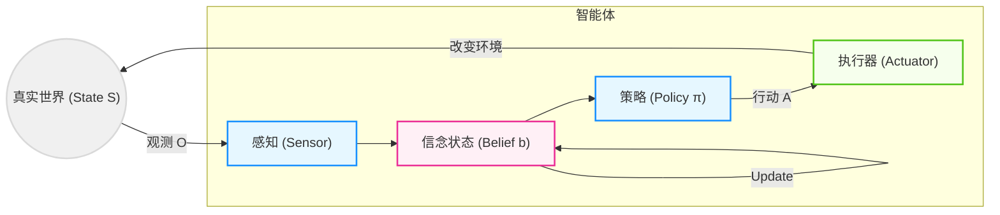

## 1.2 智能体理论基础

给大模型加上“有状态”和“循环”之所以能得到智能体，有其数学和逻辑基础。本节从人工智能的经典理论出发，推导智能体的核心运行机制，并说明这些理论如何映射到现代智能体的架构设计中。

### 1.2.1 智能体的第一性原理：理性与效用

Stuart Russell 和 Peter Norvig 在 1995 年出版的经典教材《人工智能：一种现代方法》(AIMA) 中，把 AI 的核心目标定义为构建 **理性智能体 (Rational Agent)**。

#### 什么是“理性”？

AI 理论中的“理性”不等同于人类的情感理智或全知全能，它有严格的数学定义。理性智能体是指：**“对于每一个可能的感知序列，根据已知的感知序列和内置的知识，选择能使其预期效用 (Expected Utility) 最大化的行动。”**

这可以用一个简化的决策公式表示：

$$ a^* = \arg\max_{a \in A} \mathbb{E}[U(s') | s, a] $$

其中：
*   $a^*$ 是最优行动。
*   $s$ 是当前状态，$a$ 是候选行动。
*   $s'$ 是执行行动后可能到达的新状态。
*   $U(s')$ 是新状态的 **效用值 (Utility)**。

#### 从强化学习到大模型智能体

传统的强化学习 (RL) 需要显式定义 **奖励函数 (Reward Function)** 来计算效用（例如赢了得 1 分，输了扣 1 分）。

在 **LLM 智能体** 中，“效用函数”的形式有所不同。经过 RLHF（基于人类反馈的强化学习）训练的模型，内部已经隐式地内化了符合人类价值观的效用函数；系统提示词（如“你是一个帮助用户写代码的助手”）则定义了 **当前任务的效用边界**，智能体生成的行动符合该人设和目标，就被视为“高效用”。

> **设计启示**：设计智能体的提示词，就是在定义 $U(s)$。提示词模糊不清，智能体就无法判断哪个行动 $a$ 能带来最大效用，行为随之混乱。

### 1.2.2 核心循环：从 MDP 到 POMDP

智能体与环境的交互在数学上通常被建模为 **马尔可夫决策过程 (MDP)**。但在真实世界应用中，智能体的上下文窗口与感知能力存在物理边界，更准确的模型是 **部分可观测马尔可夫决策过程 (POMDP)**。

#### 限定上下文边界

工作空间毫无约束时，智能体需要追踪的状态会爆炸（State Explosion），从而陷入幻觉与徘徊。好的智能体工程用约束条件在 POMDP 的混沌中切分出一个“确定的、边界清晰的小型 MDP (Small MDP)”交给机器求解：

- 限制它每次只处理当前函数或文件（而非整个仓库的语法树）。
- 通过检索增强（RAG）对客观事实进行投影，大幅降低环境状态的不确定性。

#### 为什么是“部分可观测”？

在 MDP（上帝视角）中，智能体能看到世界的 **全部** 状态，例如下围棋时棋盘上的一切都公开透明。在 POMDP（真实世界）中，智能体只能看到世界的 **一部分**。例如，编码智能体只能读取它打开的那几个文件，看不到其他文件，也看不到运行时的内存状态，只能通过 `ls` 或 `read_file` 等工具获得局部观测 (Observation)。

#### “记忆”的理论本质：状态估算

在 POMDP 中，仅凭当前观测 $O_t$ 无法决策。智能体需要根据观测构建和维护对世界的猜测（“我认为现在的世界是什么样的”），即 **信念状态 (Belief State)**。

图 1-2：POMDP 中的信念状态更新循环 (Belief State Update Loop in POMDP)

$$ b_t = f(b_{t-1}, a_{t-1}, o_t) $$

*   $b_t$：当前的信念状态。
*   $o_t$：最新的观测。

例如，一个编程智能体正在分析项目依赖：
- **$b_0$（初始信念）**：“我不知道这个项目用什么框架。”
- **$a_0$（行动）**：执行 `read_file("requirements.txt")`
- **$o_1$（观测）**：文件内容显示 `flask==2.0.1, sqlalchemy>=1.4`
- **$b_1$（更新后的信念）**：“这是一个使用 Flask 和 SQLAlchemy 的 Python Web 项目。”

因此 **上下文 (Context)** 在智能体系统中格外重要：它是 **信念状态 $b_t$ 的文本化表示**，而不只是聊天记录。智能体把“运行报错信息”加入上下文，就是在更新信念状态（从“代码是完美的”更新为“代码第 5 行有 Bug”）。同理，RAG 和长上下文窗口的作用是帮助智能体在部分可观测的世界中更好地估计信念状态、补足关键上下文，从而降低不确定性；它们并不能把 POMDP 变成简单的 MDP。

### 1.2.3 决策架构：从反应式到认知式

丹尼尔·卡尼曼在《思考，快与慢》中把人类思维分为系统 1（快）和系统 2（慢），[1.1.3 节「认知升级：系统 1 与系统 2」](1.1_shift.md) 已将它与 AI 的进化路径对应起来。智能体设计也经历了类似的演进。

#### 反应式架构：Reflex Agent——系统 1

反应式架构的原理是感知 -> 行动，公式为 $Action = Policy(State)$。用户问一句，LLM 答一句，没有内部独白，也没有思考过程，这是标准 LLM 的默认行为（预测下个 Token）。它的局限是无法解决需要多步推理的复杂问题。

#### 认知式/审慎架构：Deliberative Agent——系统 2

审慎架构的原理是感知 -> **构建模型 -> 规划/推理** -> 行动，即在输出行动之前引入“思考时间”，先进行内部计算。

思维链 (CoT) 不只是一种提示词技巧。从理论上看，它通过生成中间 Token，增加了模型用于当前问题的 **测试时计算量 (Test-Time Compute)**。形式上，它将 $P(y|x)$ 拆解为 $P(z|x) P(y|x, z)$，其中 $z$ 是中间推理步骤，非结构化的推理过程由此被显式化、结构化。

### 1.2.4 环境建模：PEAS 框架的现代演绎

设计智能体之前，必须先分析它所处的 **环境**。PEAS (Performance, Environment, Actuators, Sensors) 是经典的分析框架，在 LLM 时代依然适用且必要。

| 维度 | 定义 | 现代智能体设计考量 |
| :--- | :--- | :--- |
| **P**erformance |**性能度量**| 即“目标函数”，除提示词中的指令外，还包括 **量化评估指标**（如代码通过率、API 消耗成本）。**工程落地中，性能度量必须被转化为可自动执行的验收标准 (Acceptance Criteria) 或 CI 卡点阈值（例如：测试通过率 100% 且单次调用 < $0.1），否则无法进行回归优化。** |
| **E**nvironment |**环境**| 决定了架构复杂度。 •**完全/部分可观测**：是否需要强记忆模块？ •**确定/随机**：工具调用失败是否需要重试机制？ •**静态/动态**：智能体思考时环境会变吗（如股票市场）？ |
| **A**ctuators |**执行器**| 智能体的“手”。在 LLM 时代即 **Tools / Function Calling**。所有的输出（文本、JSON、API 请求）都是行动。 |
| **S**ensors |**传感器** | 智能体的“眼”。提示词的输入部分。除了用户文字，还可以是图像（Vision）、LSP 报错信息、网页 DOM 树等。 |

### 1.2.5 理论到设计的映射

下表把上述理论概念与现代智能体的工程组件做“近似对应”而非“严格同构”的映射，并不意味着形式理论已被工程实现完整等价复刻。它说明现代 Agent 系统借用了哪些经典 AI 问题设定，以及这些设定在工程里大致落在哪些模块。

| 经典 AI 理论概念 | 现代 LLM 智能体中的近似对应 | 说明 |
| :--- | :--- | :--- |
| **策略函数 Policy $\pi(a\|s)$**|**LLM + 外层控制逻辑** | 给定上下文 $s$，模型生成候选行动；最终能否执行，往往还受 harness、权限与工具路由约束。 |
| **信念状态 Belief State $b_t$**|**Context Window / Memory** | 维护当前对话历史、变量状态、环境观测的文本快照。 |
| **规划 Planning / Search**|**CoT / ReAct / Planner 模块** | 通过中间推理步骤、任务拆解或外部 planner 模块模拟搜索和规划过程。 |
| **感知 Perception $o_t$**|**输入通道与观测编码** | 将多模态信号（视觉、代码、日志）编码为 Token 序列或结构化上下文。 |
| **行动 Action $a_t$**|**Function Calling / Tool Use** | 即工具调用：输出结构化请求来触发外部代码执行。 |
| **环境反馈 / 观察更新**|**Tool Outputs / Runtime Feedback** | 工具执行结果、编译器报错、人工反馈等会更新下一轮上下文，但它们不天然等同于强化学习中的标量 reward。 |

---

**下一节**: [1.3 核心组件：大脑、感知、行动与记忆](1.3_components.md)
