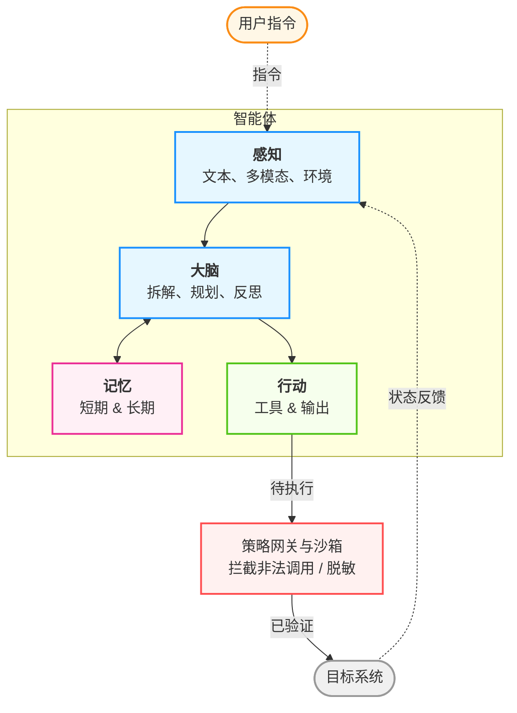

## 1.3 核心组件：大脑、感知、行动与记忆

功能完备的智能体通常由感知、规划、记忆、行动等相互协作的模块组成。本书结合当前的工程实践，把现代智能体的核心架构归纳为四个部分：
1. **大脑 (Brain)**：负责规划与决策的核心。
2. **感知 (Perception)**：信息的输入与处理。
3. **行动 (Action/Tools)**：与世界交互的接口。
4. **记忆 (Memory)**：经验和知识的存储。

图 1-3：智能体核心组件架构（含可信计算基）

> **注：可信计算基 (Trusted Computing Base, TCB)**
> TCB 是生产级智能体的必备措施。智能体能力虽强，却极易被攻击，也会产生幻觉，并非完全可信。因此行动下发至目标系统前，必须经过一层包含硬编码策略引擎、权限校验和沙箱隔离的 TCB 拦截层。

### 1.3.1 四大核心组件与思考三维框架

本书第 2–4 章拆解上述四个核心组件的工程实现。从更宏观的层面看，**Agent 时代**还需要一个思考框架，把目标、上下文和安全约束的工作统一起来。

黄东旭在 QCon 2026 提出，任何 Agent 相关的工作都可以归入以下三个维度：

1. **Goal（目标工程）**
   - Skill：如何定义和表达 Agent 应当掌握的工作流和领域知识
   - 人机交互：如何让用户高效地向 Agent 表达目标意图

2. **Context（上下文工程）**
   - Harness Engineering / Memory：Agent 执行时看到什么
   - RAG（检索增强生成）：如何动态获取相关信息
   - 信息环境：让 Agent 能够准确建立对任务状态的认知

3. **Constraints（约束）**
   - Sandbox：Agent 的执行边界
   - CICD/Lint：确定性检查和自动化验证
   - Agent Infra：运行时的安全、权限和可观测性

这个框架的要点是：**Agent 的能力不只取决于模型的智力，更取决于这三个维度的设计完整性和平衡**。初创的 Agent 系统可能只需关注目标和基础上下文；进入生产环节后，约束层的成熟度往往成为瓶颈。

### 1.3.2 大脑：核心控制器

**大脑** 由大语言模型（LLM）担任。它是整个系统的 CPU，逻辑推理、指令遵循和决策都在这里发生。

大脑的效能主要取决于两个维度：**静态的角色设定** 决定它的思维底色，**动态的推理能力** 决定它的智力上限。

#### 静态维度：角色设定

角色设定为智能体提供背景信息和行为准则。身份锚定是其中一种做法，例如“你是一个拥有 10 年经验的资深 Python 架构师，性格严谨，甚至有点强迫症。”这种设定影响说话语气，甚至能提高代码质量。另一种做法是少样本示例（Few-shot Examples）：大脑通过 **上下文学习（In-context Learning）** 学习，提供 3-5 个“完美互动的样本”，就能让它迅速掌握当前任务的特定模式。

#### 动态维度：推理能力

推理能力是智能体区别于传统软件的关键，主要包括：

* **任务拆解（Decomposition）**：将用户的模糊指令（“做个贪吃蛇游戏”）拆解为原子任务列表（UI 设计、逻辑实现、输入监听）。
* **规划（Planning）**：预判步骤之间的依赖关系，例如先查天气还是先订酒店。
* **反思（Reflection）**：一种高级功能，在输出结果前进行自我审视：“我生成的这段代码符合最佳实践吗？”

> **选型提示**：高能力模型适合充当“主脑”，处理复杂的逻辑、规划与反思；轻量模型适合充当“小脑”或“脊髓”，处理分类、摘要、路由等轻任务，成本更低。

### 1.3.3 感知：智能体的感官

感知模块负责将环境中的 **非结构化信息** 转化为大脑可以理解的 **结构化信号**（通常是文本或嵌入）。

#### 基础感知：文本输入

文本输入是最基础的感知，包括用户的指令、API 返回的 JSON 数据和错误日志。

#### 高级感知：多模态

现代智能体正在获得视觉（Vision）和听觉（Audio）。借助具备视觉能力的多模态模型，智能体可以“看”懂网页内容与界面元素，甚至从截图中定位按钮与表单；借助语音识别模型，智能体可以接入电话或会议系统，实时转录语音并做出回应。

#### 深度感知：环境状态

对编程智能体而言，感知还包括对环境的深度读取：

*   读取 IDE 当前打开的文件路径。
*   通过 `git diff` 感知代码变更。
*   通过 LSP (Language Server Protocol) 感知代码中的语法错误红线。

### 1.3.4 行动：手与工具

没有工具的智能体只是只会聊天的缸中之脑。**行动空间（Action Space）** 定义了智能体的能力边界。智能体通过工具与外部系统交互，包括信息检索、代码执行、文件操作、系统命令等，从而突破知识截止、获取实时数据、执行可靠的计算，并对真实世界产生影响。

工具使用的完整机制、类型分类与实现细节详见[第四章：工具使用与环境交互](../04_tools/README.md)。

### 1.3.5 记忆：经验的载体

LLM 本身是无状态的，**上下文窗口 (Context Window)** 又昂贵且有限。**记忆模块** 用来解决“健忘”问题。

#### 感觉记忆

感觉记忆即原始的输入流，用户提示词、系统消息最初都存储在这里。

#### 短期记忆

短期记忆对应 LLM 的 **上下文窗口**，存放当前正在进行的对话历史。它像计算机的 **RAM**，存取速度快，但断电（会话结束）即失。它的容量也受限：即便一些模型支持更长的上下文窗口，塞入太多无关信息仍会降低推理精度（**中间丢失 Lost in the Middle** 现象）。

#### 长期记忆

长期记忆通常对应 **向量数据库 (Vector DB)** 或外部存储，像计算机的 **硬盘**。记忆多到放不下 **上下文** 时，智能体先通过 **检索增强生成 (RAG)** 在向量库中检索与当前问题最相关的几条片段，只把这几条“回忆”加载到短期记忆中。智能体还可以把成功案例总结成经验存入长期记忆，下次遇到类似问题时表现更好。

详见[第三章：记忆系统架构](../03_memory/README.md)。

---

**下一节**: [1.4 智能体的认知层级](1.4_cognitive_levels.md)
