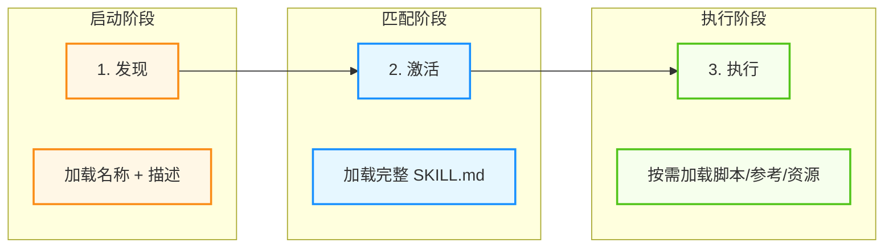
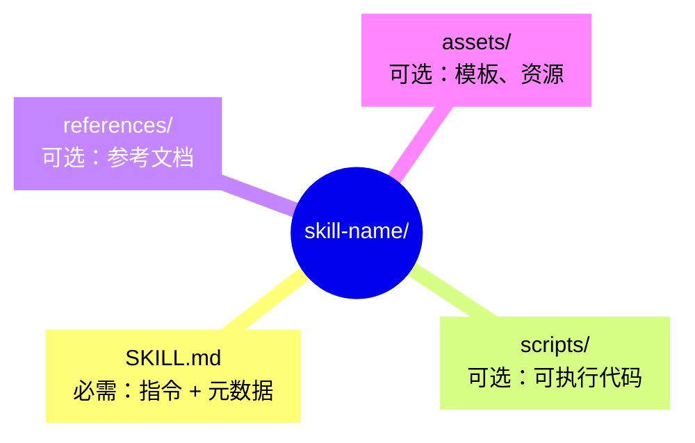
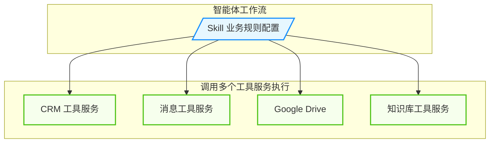

## 4.4 智能体技能：能力扩展规范

**智能体技能（Agent Skills）** 是一种扩展 AI 智能体能力与专业知识的开放格式，以轻量、可移植的方式封装领域知识和工作流程。

> **说明**
> **定位说明**：本节讨论的是 **Agent Skills 开放标准** 这一层，即以 `SKILL.md` 为核心的可移植技能格式。不同厂商产品还可能提供 rules、subagents、project instructions、`AGENTS.md` 等其他“指令表面”，它们不等同于 Agent Skills，也不应混写成同一套加载机制。应先写清标准层，再分别说明各产品是否兼容、如何映射。

### 4.4.1 什么是智能体技能

工具连接协议提供系统连接能力，Skills 则专注于封装 **过程性知识**。

> 工具连接协议是 **通道**，技能是 **智慧**。
>
> 工具连接协议解决“通过什么做”，技能解决“如何做”。

Skills 可以把法律审查流程、数据分析管道等领域专业知识封装为可复用指令，赋予智能体创建演示文稿、构建工具服务、分析数据集等新能力，把多步骤任务转化为一致、可审计的工作流程，并在兼容 Skills 的不同智能体产品之间复用同一技能。

2026 年的论文 [SkillsBench: Benchmarking How Well Agent Skills Work Across Diverse Tasks](https://arxiv.org/abs/2602.12670) 给出了一个重要的经验事实：**Skill 是可以被单独测量、并且经常显著提升智能体表现的工程变量，而不是“可有可无的提示词附件”。**

该论文通过严格的实验设计量化了 Skills 的效果。它把任务分为 **无 Skills**、**人工策展 Skills**、**模型自生成 Skills** 三种条件进行比较，覆盖 8 个领域、87 个任务。主要发现包括：

- **人工策展的 Skills 平均能显著提升完成率**，说明高质量过程性知识在推理时注入是有效的。
- **模型现写的 Skills 平均没有稳定收益**，说明“会使用程序性知识”和“会编写高质量程序性知识”是两种不同能力。
- **领域差异极大**：收益从软件工程的 +4.5pp 到医疗的 +51.9pp 不等，但**所有领域的总体增益都是正的**；负收益出现在**单个任务**这一层（84 个任务里有 16 个），而不是整个领域。因此 Skill 要面向任务类别精确设计，不能抽象地“加说明书”：同一领域内也会有被 Skill 拖累的具体任务。
- **聚焦型 Skill 往往优于大而全的文档**：2 到 3 个模块、围绕一个清晰工作流组织的 Skill，通常比塞满背景材料的综合手册更有效。
- **小模型 + 好 Skill 可以逼近大模型裸跑**：Skill 因此也是一种现实的成本优化手段。

这些结论直接影响工程实践：团队如果已经在做工具调用、RAG 和记忆系统，却还没有把“任务类程序知识”当作独立资产管理，通常还有一整块性能提升空间尚未开发。

进一步的 Skill 优化研究把 Skill 推进到“可训练资产”层面。以 SkillOpt 为代表的方法不直接更新模型权重，而是把单个 Skill 文档视为冻结智能体的外部状态：目标智能体先在任务集上执行当前 Skill 并产生 scored rollout，优化器再根据成功和失败轨迹提出受控的新增、删除或替换编辑，候选 Skill 只有在 held-out 验证集上严格提升时才被接受。可见，高质量 Skill 的维护不应停留在“写一份说明书”，而应具备版本、评估、回归和拒绝编辑记录。

### 4.4.2 Skills 工作机制

Skills 采用三阶段加载机制：



图 4-5：Skills 三阶段加载机制

1. **发现（Discovery）**：启动时仅加载每个技能的 name 和 description，足以判断其相关性
2. **激活（Activation）**：当任务匹配某个技能的描述时，将完整 SKILL.md 指令加载到上下文
3. **执行（Execution）**：智能体按照指令执行，按需加载引用的文件或执行捆绑的脚本

### 4.4.3 Skill 目录结构

一个 Skill 的标准目录结构如下：



图 4-6：Skill 的标准目录结构

| 目录/文件 | 说明 |
|-----------|------|
| `SKILL.md` | **必需**。包含元数据和详细指令 |
| `scripts/` | 可执行脚本，应自包含或清晰声明依赖 |
| `references/` | 技术参考文档，如 REFERENCE.md、领域专用文档 |
| `assets/` | 模板、图片、数据文件等资源 |

### 4.4.4 SKILL.md 格式规范

SKILL.md 由 YAML Frontmatter 和 Markdown 正文两部分组成。

#### 前置元数据（必需）

以下是一个完整的 YAML Frontmatter 示例：

```yaml
---
name: pdf-processing
description: Extract text and tables from PDF files, fill forms, merge documents.
license: Apache-2.0
compatibility: Designed for agentic coding hosts
allowed-tools: Bash(git:*) Bash(jq:*) Read
metadata:
  author: example-org
  version: "1.0"
---
```

| 字段 | 要求 | 说明 |
|------|------|------|
| `name` | 必需 | 1-64 字符，仅小写字母、数字和连字符 |
| `description` | 必需 | 1-1024 字符，描述功能和使用场景 |
| `license` | 可选 | 许可证信息 |
| `compatibility` | 可选 | 环境要求，如“需要 git、docker” |
| `allowed-tools` | 可选 | 预授权工具列表 |
| `metadata` | 可选 | 自定义键值对 |

#### 正文内容

正文采用 Markdown 格式，应包含：

- 分步骤指令
- 输入输出示例
- 常见边界情况处理

以下是一个 SKILL.md 正文的典型结构示例（示意采用英文小节名，实际项目可使用中文）：

```markdown
# PDF 处理

### 何时使用

当用户需要处理 PDF 文件时使用本技能。

### 如何抽取文本

1. 使用合适的 PDF 解析工具抽取文本。

### 如何填写表单

...
```

### 4.4.5 渐进式披露

Skills 采用三层加载机制优化上下文使用：

| 层级 | 内容 | Token 预算 | 加载时机 |
|------|------|-----------|---------|
| 元数据 (Metadata) | name + description | ~100 tokens | 启动时加载所有 Skills |
| 指令 (Instructions) | 完整 SKILL.md 正文 | <5000 tokens（建议） | 任务匹配时激活 |
| 资源 (Resources) | scripts/、references/、assets/ | 按需 | 执行时按需加载 |

这种设计使启动时的上下文开销极小，详细指令仅在需要时加载，大型资源文件按需获取。


结合工业实践与 SkillsBench 的结论，高质量 Skill 的设计原则可以概括为三条：

1. **写过程，不写答案**：Skill 应当告诉智能体“如何排查、如何验证、如何收尾”，不要直接塞进某一道题的最终输出。
2. **聚焦任务类，不追求百科全书**：一个 Skill 最好只覆盖同一类问题的稳定工作流，功能边界越清晰，触发越稳定，负迁移越少。
3. **把确定性逻辑下沉到脚本和资源**：长文档、模板、校验脚本、示例数据尽量放在按需层，不要把所有内容堆进 `SKILL.md`。

一个 Skill 如果变成“十几页背景知识 + 各种顺手塞进去的技巧合集”，大概率已经从“高密度程序性知识包”退化为“低命中率说明书”。

### 4.4.6 Skill 的局限与进化方向

当前的 Skill 框架已是 Agent 软件的“及格线”，但并非最终形态。黄东旭在 QCon 2026 指出，未来的 Agent 系统需要更复杂的抽象形式，具备以下特性：

1. **可调试性（Debuggability）**：Skill 应该能像软件模块一样被诊断、定位和修复错误
2. **可分发性（Distributability）**：不仅可复用，还能跨智能体系统、跨组织分发和版本管理
3. **知识蒸馏（Knowledge Distillation）**：能够将复杂的人类专家知识编码为可学习、可优化的形式，而非单纯的指令文本

当前的 Skill 主要以自然语言指令的形式存在，缺乏结构化的执行语义和自适应能力。下一代 Agent 基础设施可能需要结合 GStack、Superpower 等更有结构的知识表达方式，实现“人机协同生成”，即通过自然语言与 Agent 协同迭代定义 Skill，不再只靠人工单向编写。这一演进将使 Skill 从“静态知识包”变为“动态学习资产”。

把这个方向工程化，Skill 的生命周期至少包含四个动作：先用真实或合成任务建立基线，再把失败轨迹压缩为候选规则，然后通过小步编辑更新 Skill，最后用未参与编辑的评估集决定是否发布。关键在于把自我改进限制在可审计、可回滚、可验证的配置层，不能让智能体随意修改自己的说明。

### 4.4.7 Skills 与工具连接协议的协同

技能和工具连接协议是互补的：技能定义“做什么”和“怎么做”，协议提供“用什么工具做”。

#### 协同架构

图 4-7 展示二者的分工：技能提供业务规则与流程，协议提供实际可调用的工具。



图 4-7：Skills 与工具连接协议协同架构

*注：Skill 定义了工作流程、业务规则和质量标准等过程性知识。例如“查询客户数据时，先检查 CRM，再交叉验证 Slack”。*

#### 边界划分

| 维度 | 协议负责 | 技能负责 |
|------|---------|------------|
| 核心 | 连接能力 | 领域知识 |
| 内容 | API 格式、查询语法 | 工作流程、业务规则 |
| 指令 | 工具使用提示 | 多工具编排逻辑 |
| 粒度 | 单个服务 | 跨服务流程 |

经验上，协议指令覆盖 **如何正确使用服务及其工具**，Skill 指令覆盖 **如何在特定流程或多服务工作流中使用它们**。

#### 实际案例

下面两个示例展示 Skill 如何把方法论与流程固化为可复用能力。

**案例 1：财务分析 Skill**

```markdown
# Comparable Company Analysis Skill

### 工作流程

1. 从财务数据工具服务拉取指标
2. 从补充数据工具服务获取额外字段
3. 应用估值方法论（Skill 定义）
4. 格式化输出符合合规要求（Skill 定义）
```

**案例 2：会议准备 Skill**

```markdown
# Meeting Intelligence Skill

### 工作流程

1. 通过知识库工具服务搜索相关项目页面
2. 通过知识库工具服务获取历史会议记录
3. 整理为两份文档：内部预读 + 外部议程
4. 通过知识库工具服务保存到指定位置
```

### 4.4.8 Skills 生态与企业部署

#### 组织级管理

在团队/组织场景下，Skills 往往需要作为“可审计的组织资产”管理，涉及版本控制、审批、权限与分发。

组织管理员可以在管理设置中集中配置 Skills，这些 Skills 默认对所有用户启用，用户仍可关闭个别 Skills 以自定义体验。这种部署方式保证团队使用一致、经批准的工作流：整个组织遵循相同的工作流程，IT 团队负责审核和批准，一次配置即全员可用，用户也保留个性化选择权。

#### 版本化与回归

Skill 用于关键业务流程时，建议把它当作“可发布的软件资产”治理：

- **版本管理**：为 Skill 建立语义化版本号与变更日志，支持回滚。
- **审批与灰度**：在推广到全员前先做小范围试点，避免一次性引入大范围回归。
- **回归样例集**：为核心 Skill 维护最小回归用例（输入、期望输出结构、失败诊断），每次更新前后对比。

#### Skills 目录与生态

生态与具体合作伙伴会随时间变化。工程上更重要的是能否把 Skill 当作可版本化的资产（仓库管理），能否做审批与分发，能否与权限/审计体系集成。

#### 创建与编辑体验优化

创建 Skill 有多种方式：描述需求，由系统/助手协助构建（描述即创建）；直接编写指令文件；上传完整的 Skill 文件夹结构；部分宿主还提供内置创建器（Skill creator / scaffolding 工具），帮助生成初始 Skill 结构。

启用之前，用户可以完整预览 Skill 的内容，理解它具体做什么，并审核指令的安全性和合理性。之后，助手还可以帮助编辑现有 Skills，根据反馈优化指令，迭代改进工作流。

#### 跨平台可用性

Agent Skills 作为开放标准，目标是让同一个 `SKILL.md` 目录结构在多个兼容宿主之间复用，但**具体产品表面必须分开描述**：

- **标准层**：Skill 是目录 + `SKILL.md` + 可选的 `scripts/`、`references/`、`assets/`，宿主按“发现 → 激活 → 按需加载”使用它。
- **兼容宿主层**：像 Codex 这类已公开支持 Agent Skills 的宿主，会扫描技能目录并显式或隐式激活 `SKILL.md`。在 Codex 的产品化插件中，plugin 不是单个 Skill，而是可以把 apps、skills、instructions 和 workflows 一起打包的分发层；这有助于把某个角色或团队的重复工作沉淀成可安装能力包。
- **非等价表面**：另一些产品可能提供 rules、subagents、组织级工作流模板或浏览器扩展中的技能入口；它们是否直接兼容 Agent Skills，要以各自官方文档为准，不能把 UI 入口、配置路径或 API 端点写成通用规范。

> **说明**
> **工程建议**：编写文档时先描述开放标准，再单列“OpenAI/Codex”“Anthropic/Claude”“其他 IDE/客户端”等厂商章节，分别说明触发方式、权限前置条件和分发机制。

### 4.4.9 最佳实践

开发和使用 Agent Skills 时，遵循以下经过验证的实践，可以显著提高技能的质量和可用性，避开常见陷阱。

#### Skill 设计原则

- **功能聚焦**：每个 Skill 专注于一个明确的领域或工作流
- **自文档化**：任何人阅读 SKILL.md 都能理解其功能
- **可移植性**：Skills 就是文件，易于编辑、版本控制和分享

#### 避免常见问题

- **避免指令冲突**：工具服务指定返回 JSON，而 Skill 要求 Markdown 表格时，智能体只能猜测。应让工具服务处理连接，Skill 处理呈现。
- **保持复用性**：一个工具服务可支持多个 Skills；一个 Skill 可编排多个工具服务。
- **利用渐进式加载**：将详细参考资料放在 references/ 目录，仅在需要时加载

#### 验证工具

可以使用项目提供的校验脚本或自定义 linter 验证 Skill 格式：

```bash
<skill-linter> check ./my-skill
```

> **提示**
> **相关资源**：建议在项目内维护一份“Skill 规范/示例/校验工具”的链接清单，并定期核验有效性。

---

**下一节**: [4.5 浏览器自动化与计算机操作](4.5_browser.md)
