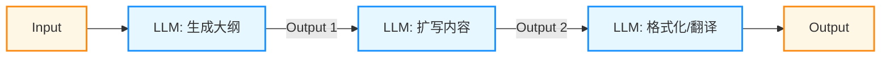
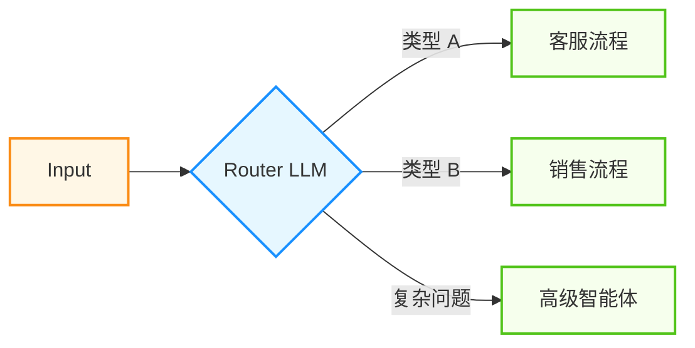
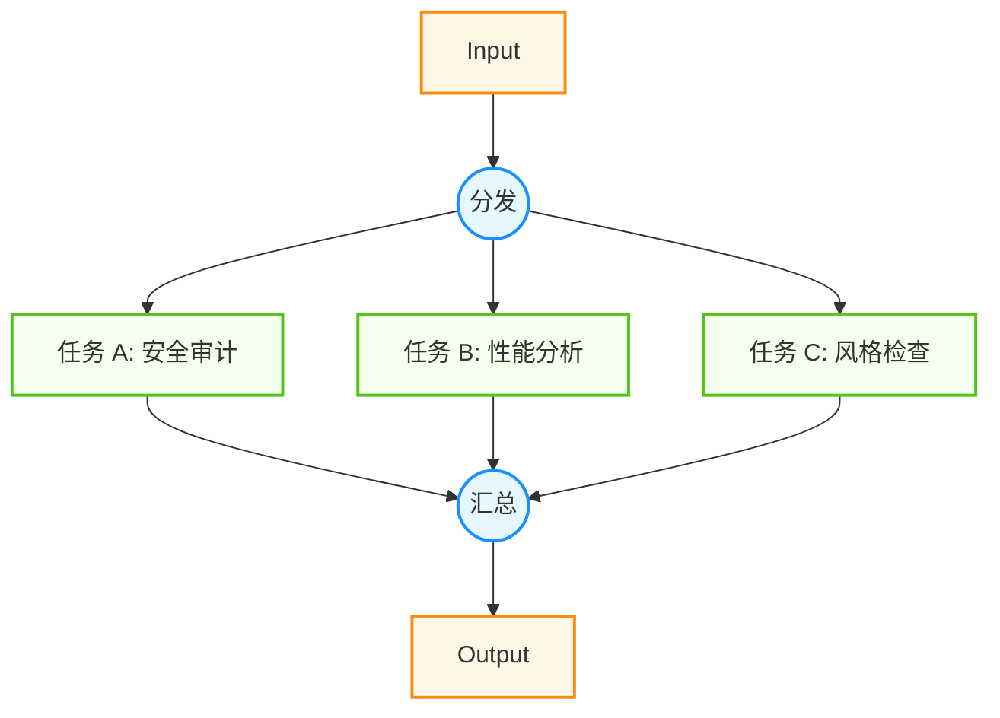
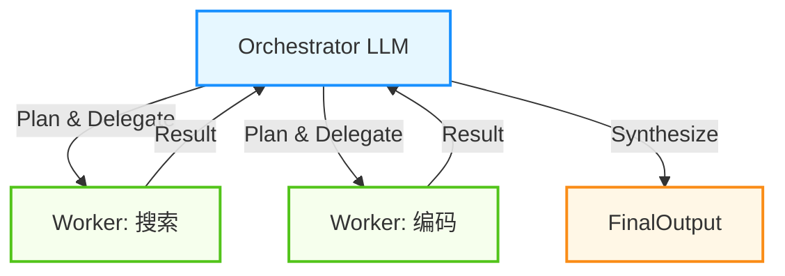
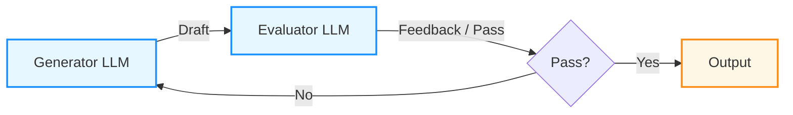
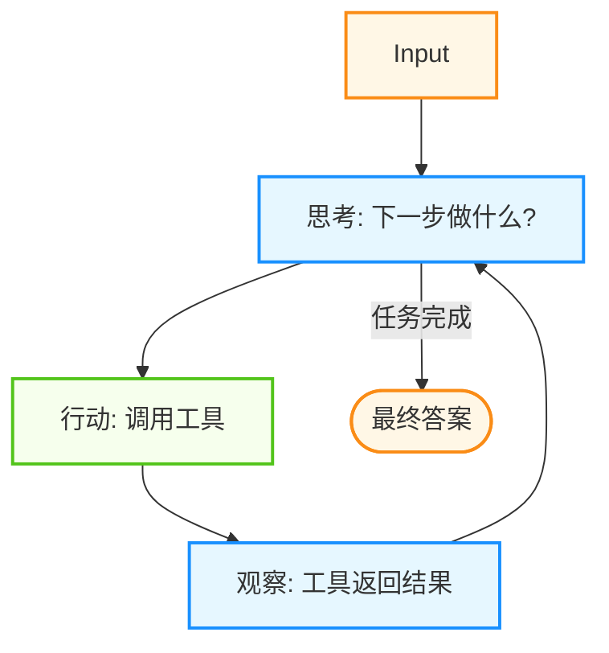

## 9.1 设计模式：从 Workflow 到智能体

最成功的系统往往使用简单、可组合的模式，而不是最复杂的框架。

在构建 LLM 应用时，常面临一个核心选择：**谁来负责编排多个智能体和任务？**

按编排方式，系统可分为两种典型架构：

**静态编排**是指由代码主导（Code-driven）的编排：开发者预先定义好执行路径（如 `if/else`, `loop`）。LLM 可以参与决策，但只能在 **预定义的路径** 中选择，无法改变系统预设的 **控制流拓扑**。这种架构确定性强，路径固定，性能可控。

**自主编排**是指由模型主导（Model-driven）的编排：系统给予 LLM 目标和工具，由 LLM 自主决定执行步骤，并根据环境反馈动态调整策略，决定“下一步做什么”。这种架构适应性强，能应对未知情况，但不可控性增加。

> **注意**：
> 静态编排和自主编排并不对立，实践中往往结合使用。越接近自主编排，系统越灵活，但可靠性越难保证；越接近静态编排，系统越稳定，但泛化能力越弱。

下面分别介绍这两种架构下的核心设计模式。

### 9.1.1 静态编排：代码主导的工作流

当任务可以被清晰分解时，应优先使用 **静态编排**。它能提供更高的可预测性和更低的延迟。

### 1. 提示词链

提示词链是最基础的模式：将任务分解为一系列线性步骤，上一步的输出作为下一步的输入。



图 9-1：提示词链模式

提示词链适用于文案生成（大纲->初稿->润色）和简单的数据处理管道。它延迟较低，易于调试，每个节点可以使用不同规格的模型（例如大纲用高质量模型，扩写用低成本模型）；代价是中间某一步出错时，错误会级联传导。

### 2. 路由分发

根据输入内容的分类，将其导向不同的后续流程，使每类输入由专门的流程处理，体现 **专业化分工**。



图 9-2：路由分发模式

路由分发的典型场景有两类：一是**客服分流**，根据用户意图（售后/投诉/咨询）路由到不同处理模块；二是**模型分层**，简单问题路由给低成本模型，复杂问题路由给高质量模型。Router 可以是一个专门微调过的分类小模型，也可以是基于 Embedding 的向量相似度匹配，只需极低的开销。

### 3. 并行执行

利用 LLM 并行处理能力，同时执行多个任务，提升速度或质量。包括两个变体：

* **切片**: 将大任务拆解为独立的子任务并行处理。
    *   *例子*: 给出一段长代码，同时运行三个 LLM 分别检查“安全性”、“性能”和“代码风格”，最后汇总。
* **投票 (Voting / Majority Vote)**: 对同一任务运行多次，通过投票减少幻觉。
    *   *例子*: 让 3 个模型分别“找出文中的事实错误”，取交集或多数票。



图 9-3：并行执行模式

### 4. 编排者-工作者

当子任务无法预知或需要动态生成时，由一个中心编排者来分派任务，其结构类似“包工头”带领一群“工人”。



图 9-4：编排者-工作者模式

* **流程**:
    1.  Orchestrator 分析用户请求，分解出需要执行的子任务。
    2.  并行或串行调用相应的 Worker LLM 或工具。
    3.  收集 Worker 的结果，进行综合（Synthesize），生成最终回复。

该模式适用于复杂编码任务（修改一个功能涉及多个文件）和多源信息调研。它的子任务列表是动态的，但 **执行模式是固定的**（例如：Split -> Map -> Reduce），因此仍属于静态编排；自主智能体则可以自主决定是否循环、调用何种工具，流程拓扑是动态的。

### 5. 评估者-优化者

评估者-优化者模式即经典的 **反思** 模式，它在循环流程中引入“评估者”角色来提升质量。



图 9-5：评估者-优化者模式

评估者-优化者的流程是：生成器 (Generator) 生成初稿 -> 评估者 (Evaluator) 提出修改意见 -> 生成器 (Generator) 优化 -> 循环。它适用于高质量翻译、复杂代码生成等场景。必须设置明确的终止条件（如最大循环次数或评分阈值），防止死循环。对 max_iterations 应做降级处理：达到最大迭代次数仍未通过评估时，返回迄今为止质量最优的方案，而非抛出异常。

```python
# 评估者-优化者的健壮实现

best_result = None
best_score = -1

for iteration in range(max_iterations):
    result = generator.generate(task)
    score = evaluator.score(result)

    if score > best_score:
        best_score = score
        best_result = result

    if score >= pass_threshold:
        return result  # 通过评估，立即返回

    if iteration == max_iterations - 1:
        # 最后一轮未通过，返回最优方案
        return {
            "result": best_result,
            "score": best_score,
            "status": "max_iterations_reached",
            "message": f"未在 {max_iterations} 轮内通过评估，返回最优方案"
        }
```

---

### 9.1.2 自主编排：智能体与动态决策

当无法预定义路径时，需要让 LLM 接管控制权，即 **自主编排** 模式。此时智能体除调用工具外，还要运行一个 **认知循环**。

常见的自主编排模式包括：ReAct、规划与执行、多智能体协作。

### 1. ReAct

ReAct 是最经典的单智能体模式（详见 [2.3 节](../02_reasoning/2.3_react.md)）。



图 9-6：ReAct 循环模式

* **Traces 示例**:
    ```text
    Thought: 用户想知道北京现在的天气。我需要调用天气查询工具。
    Action: search_weather(city="Beijing")
    Observation: 25°C, Sunny.
    Thought: 此时天气不错。用户还问了适合穿什么。基于天气...
    Action: search_clothing_recommendation(temp="25°C")
    ...
    ```

ReAct 的核心挑战是容易陷入循环，或在高压环境下（如复杂多步推理）迷失目标。

### 2. 规划与执行

规划与执行模式引入显式的 **规划** 阶段，以解决 ReAct “走一步看一步”导致的短视问题。

* **阶段一：规划 (Planner)**：LLM 接收复杂请求后不直接执行，而是输出一个 `Step-by-Step Plan`。
* **阶段二：执行 (Executor)**：按照 Plan 逐条执行。如果执行中遇到阻碍，可以请求 Planner **重规划 (Replanning)**。

> **提示**：
> **Cursor 的 Plan Mode** 就是这种模式的最佳实践。它先扫描代码库，生成 Implementation Plan，用户确认后，再一步步 Apply Changes。

### 3. 多智能体协作

单体智能体复杂度过高时，通常将其拆分为多智能体系统。常见的组织方式有三种：

* **层级制**：类似公司组织架构。**管理智能体** 负责拆解目标、监督进度、协调资源；**专家智能体** 专注特定领域（如 DB 设计专家、前端专家、QA 专家）。其优势是权责分明，管理者可以纠正下属的错误。
* **协作制**：类似头脑风暴会议。多个智能体（如 Developer + Tester）处于同一个会话中，都能通过消息总线发言，通常需要一个发言选择（Speaker Selection）机制来决定下一个发言者。
* **竞争制**：多个智能体对同一问题持不同立场，通过辩论提升决策质量，详见 [6.3 节博弈论视角下的冲突解决](../06_communication/6.3_game_theory.md)。

### 9.1.3 模式选择指南

选择模式主要参考 **不确定性** 和 **复杂性** 两个维度，这对应认知科学中的 **快思考** 与 **慢思考** 理论。

| 模式 | 认知模式 | 适用场景 | 复杂度 | 成本 |
| :--- | :--- | :--- | :--- | :--- |
| **提示词链** | 快思考 | 任务固定，步骤明确 | ⭐ | 💲 |
| **路由分发** | 快思考 | 任务有几个明确变体 | ⭐⭐ | 💲 |
| **并行执行** | 快思考 | 独立子任务，关注速度/覆盖面 | ⭐⭐ | 💲💲 |
| **编排者模式** | 混合态 | 动态子任务，需要统一协调 | ⭐⭐⭐ | 💲💲 |
| **评估优化** | 慢思考 | 质量优先，容忍高延迟 | ⭐⭐⭐ | 💲💲💲 |
| **ReAct 智能体** | 慢思考 | 开放式探索，步骤未知 | ⭐⭐⭐⭐ | 💲💲💲 |
| **自主规划** | 慢思考 | 极度复杂，长跨度任务 | ⭐⭐⭐⭐⭐ | 💲💲💲💲 |

> **重要**：
> **Start Simple**: 总是从简单的静态编排开始。只有当固定流程无法应对需求的变化时，才引入自主编排。过早引入自主编排会导致系统变得不可预测且难以调试。

### 9.1.4 行业最佳实践

#### Agentic Workflows：把模式编排成生产流水线

前面的 ReAct、规划与执行、多智能体协作、评估优化，都是同一个更大范式的组成部分：**Agentic Workflows**。

Agentic Workflows 的核心思想是围绕模型设计一条可重复、可观测、可纠错的工作流，而不是让一个更聪明的模型一次性回答所有问题。常见的四个积木是：

1. **Reflection**：让系统检查自己的工作
2. **Tool Use**：让系统调用外部工具与环境交互
3. **Planning**：让系统先拆任务、再执行
4. **Multi-Agent Collaboration**：让多个角色分工协作

可以把它理解为一个分层工作流：

| 层 | 典型模式 | 解决什么问题 |
|----|----------|--------------|
| **执行层** | Tool Use / ReAct | 当前这一步该做什么 |
| **规划层** | Plan-and-Execute | 整个任务应该怎么拆 |
| **质量层** | Reflection / Evaluator | 当前结果是否足够好 |
| **组织层** | Multi-Agent | 谁来做、谁来审、谁来汇总 |

生产系统中，这四层往往组合出现。例如，Orchestrator 先生成全局计划，每个子任务内部再运行一轮小型 ReAct 循环，关键结果交给 Reviewer 做 Reflection，最终由多智能体协作完成整体交付。

这种组合是智能体系统从“会调用几个工具的 Demo”走向“能稳定交付业务结果的生产系统”的分水岭。

#### 行业共识

工程实践反复验证的一条经验是：**优先使用简单、可组合的静态模式**，必要时再引入更强的自主性与动态规划。

围绕“跨模型/跨工具互操作”的标准化工作也在推进，例如将“工具描述、权限边界、上下文传递、可观测性事件”做成可移植的协议与数据结构（相关内容可结合 [4.3 节](../04_tools/4.3_mcp.md) 阅读）。这些工作使上述设计模式更容易跨框架复用。

#### 落地清单

把设计模式从概念推进到上线之前，可以先用以下最小清单自检：

- 明确任务完成条件与最大步数，避免无限循环
- 为高风险工具设置审批与最小权限，并在运行时硬拦截
- 为关键链路打上 `trace_id`，并记录工具调用与结果作为证据链
- 维护回归样例集，支持版本对比与灰度发布

#### 案例：Claude 设计系统的智能体工作流

Anthropic 在 Claude 设计工具中实现了一套完整的 Agent 工作流，其系统提示词可作为 Agent 设计模式的生产实践参考。

**六步 Agent 循环**。该系统将设计任务分解为六步：(1) 理解需求，对新任务提出澄清问题，明确输出物、保真度、约束条件；(2) 探索资源，阅读设计系统定义及关联文件；(3) 制定计划，创建待办清单；(4) 搭建结构，准备文件夹和资源；(5) 执行交付，产出设计文件并验证无错误；(6) 简短总结，只写注意事项与下一步。这个循环是典型的 Plan-Act-Observe 模式，但在每一步都注入了领域特定的行为约束。

**上下文窗口管理**。该系统引入了 `snip` 机制：当一个工作阶段完成（一次探索已解决、一次迭代已收敛），Agent 将该区间标记为可移除。标记延迟执行，只有当上下文压力增大时才统一清理。这种“惰性回收”策略避免了两个极端：频繁清理导致丢失有用上下文，从不清理导致窗口溢出。长期运行的 Agent 系统可以借鉴这一设计。

**工具使用规范与信息隐藏**。系统严格区分“能力描述”和“实现细节”：Agent 可以告诉用户“我能创建 HTML 和 PPTX 文件”，但绝不暴露工具名称、系统标签或内部机制。这种信息隐藏既出于安全需要，也降低了用户试图直接操控工具链的风险，可供 Agent 系统的 API 设计参考。

### 9.1.5 长期运行的智能体设计模式

当智能体任务跨越数小时甚至数天时，设计模式需要专门考虑。学术界与工业界在 2025-2026 年总结了几个关键的长期运行模式。

#### 计划、文档与 Git 驱动

在长期科学计算和代码生成任务中，**蓝图文件（Blueprint File）** 模式被证实有效。核心要素包括：

1. **CLAUDE.md 计划蓝图**：项目初期，生成一份结构化计划文件，列举可交付成果、成功标准、架构决策。这个文件在整个开发过程中保持在智能体的上下文中，作为目标锚点。

2. **CHANGELOG.md 进度记录**：维护一份“实验室笔记”，记录已完成任务、失败的尝试、性能基准和已知限制。**失败的方案同样重要**：记录下来可以防止后续会话重复踩坑。

3. **版本控制驱动的进度监控**：指示智能体在有意义的工作段后执行 Git 提交，并在提交前运行测试套件。Commit 历史成为可审计的进度证明。

4. **测试预言与量化目标**：建立可测试的参考标准（如单元测试、性能基准、精度指标）。Long-term Agent 相比短期 Agent 更需要显式的成功标准，而非模糊的“质量好”。

#### 编排循环与任务验证

应对“智能体懒惰”的常见策略是 **Ralph Loop**：反复验证任务完成情况，直到满足规范。它不依据单次推理就判定任务完成，而是通过多轮检查确保交付物达标。

#### 看板驱动的持续编排：Symphony 模式

OpenAI 于 2026 年 4 月开源的 **Symphony** 规范是长期运行智能体的另一个生产级参照，其核心理念是 **将项目管理看板（如 Linear）变为智能体的控制平面**。

Symphony 的运行模型是一个持续轮询的守护进程：

1. **Poll**：从 Issue Tracker 读取待处理任务。
2. **Dispatch**：为每个任务创建隔离工作区（独立 git clone）。
3. **Resolve**：在隔离环境中运行 coding agent 会话，直到交付物通过验证。
4. **Land**：生成 PR 并交由人工审查，合格后合入主线。

其设计要点包括：每个任务拥有独立的沙箱与分支，避免并发冲突；规范本身以 Markdown（`SPEC.md`）形式存在于仓库中，可版本化、可审计；人工始终保留最终审批权。这是“编排者-工作者”模式（9.1 第 4 节）在持续运行场景下的具体工程化实现。

---

**下一节**: [Harness 架构：智能体的执行与治理层](9.2_harness.md)
