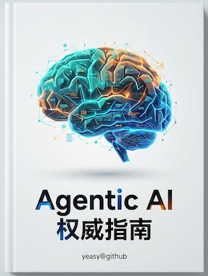

# 智能体 AI 权威指南

从单体设计到多智能体协作，掌握智能体的开发、评估与治理。

**[在 GitBook 阅读第一章 · 智能体范式](https://yeasy.gitbook.io/agentic_ai_guide/di-yi-bu-fen-dan-ti-zhi-neng-jia-gou/01_paradigm)**

[全书目录（GitHub）](https://github.com/yeasy/agentic_ai_guide/blob/main/SUMMARY.md) · [正式 PDF（发布页）](https://github.com/yeasy/agentic_ai_guide/releases/latest)



## 关于本书

对话式大模型普及之初，人们看到的是它们的涌现能力；如今，人工智能正从“能对话的 AI”迈向“能行动的 AI”。智能体 AI（Agentic AI）让人工智能从被动响应走向主动规划，从单轮交互走向持续协作，从辅助工具走向自主伙伴，人机关系也随之改变。

《智能体 AI 权威指南》系统讲解智能体技术，内容从底层原理到架构设计，从主流框架到工程实践，构成完整的知识体系。

## 从哪里开始

- **初次接触智能体** · 从[第一章 智能体范式](https://yeasy.gitbook.io/agentic_ai_guide/di-yi-bu-fen-dan-ti-zhi-neng-jia-gou/01_paradigm)开始，了解一个智能体怎样规划任务、调用工具并根据结果继续行动。
- **动手开发智能体** · 先读 [ReAct](https://yeasy.gitbook.io/agentic_ai_guide/di-yi-bu-fen-dan-ti-zhi-neng-jia-gou/02_reasoning/2.3_react)和[工具使用机制](https://yeasy.gitbook.io/agentic_ai_guide/di-yi-bu-fen-dan-ti-zhi-neng-jia-gou/04_tools/4.2_tool_use)，用熟悉的大模型 API 为一个查询任务接入工具，检查每轮调用和返回结果。
- **做技术选型与上线评审** · 用[框架选型指南](https://yeasy.gitbook.io/agentic_ai_guide/di-san-bu-fen-gong-cheng-shi-jian-yu-luo-di/08_frameworks/8.1_ecosystem)比较候选架构，再用[生产化检查清单](https://yeasy.gitbook.io/agentic_ai_guide/di-san-bu-fen-gong-cheng-shi-jian-yu-luo-di/09_agentops/9.8_experiment_to_production)检查试点是否达到上线条件。
- **评估试点投资与治理** · 先读[自主度与监控](https://yeasy.gitbook.io/agentic_ai_guide/di-san-bu-fen-gong-cheng-shi-jian-yu-luo-di/09_agentops/9.9_autonomy_metrics)，确定授权范围和人工接管条件。随后建立成本与收益基线，落实治理责任，检查用户能否撤销操作，再评估扩大试点的风险。

本书假设读者对 AI 和大语言模型有基本了解。可先读[《零基础学 AI》](https://yeasy.gitbook.io/ai_beginner_guide)补足基础概念，或读[《大模型提示词工程指南》](https://yeasy.gitbook.io/prompt_engineering_guide)练习提示词设计。

<details>

<summary>高管决策路线</summary>

1. [定义可接受的自主度与升级边界](09_agentops/9.9_autonomy_metrics.md)，确定授权层级、人工接管点和成功指标。
2. [建立成本、性能与 ROI 基线](09_agentops/9.4_optimization.md)，用真实采样评估单位经济性。
3. [落实企业治理与运行责任](09_agentops/9.5_enterprise.md)，为权限、审计、合规和事故响应指定负责人。
4. [设计可理解、可撤销的人机体验](04_tools/4.7_agentic_ux.md)，验证用户能否理解系统行为、撤销操作并安全接管。
5. [审查对齐与长期外部性](11_future/11.2_alignment.md)，在扩大自治范围前复核目标偏移、滥用与系统性风险。

</details>

<details>

<summary>全书结构与按角色选读</summary>

- **单体智能架构（第 1–4 章）** · 了解感知、推理、规划、记忆与工具调用，学习 ReAct、规划与执行等常见模式。
- **群体智能与进化（第 5–7 章）** · 学习多智能体协作、通信协议、社会模拟，以及从反馈中学习、评估和持续改进智能体的方法。
- **工程实践与落地（第 8–10 章）** · 比较链式、图式、数据驱动的 RAG 与多智能体编排框架，学习 AgentOps 和智能体编程实践。
- **未来展望（第 11 章）** · 理解安全、伦理与价值对齐的边界，了解通向通用人工智能的技术路径。
- **附录（第 12 章）** · 查阅术语、论文、AGENTS.md 规范、案例模板与检查清单。

| 读者角色 | 阅读顺序 | 学习重点 |
| --- | --- | --- |
| **AI 工程师** | 第 1–4 章 → 第 8–10 章 | 单体智能机制、框架与 AgentOps |
| **技术负责人** | 第 1–2 章 → 第 5–6 章 → 第 8 章 | 多智能体协作架构和框架选型 |
| **产品经理** | 第 1–2 章 → 第 5 章 → 第 11 章 | 用能力边界和协作模式判断产品方案 |
| **研究者与学生** | 第 1–7 章 → 第 11 章 | 智能体架构原理、评估方法与研究方向 |

模型可用性、API、协议和基准等易变信息见[快变事实核验表](12_appendix/12.5_volatile_facts.md)。核验表按 30 天有效期复核，若正文与之有差异，请参照表中链接的官方来源和冲突状态。

</details>

## 延伸阅读

<details>

<summary>相关系列图书</summary>

- [《大模型上下文工程权威指南》](https://yeasy.gitbook.io/context_engineering_guide) · 深入理解智能体的上下文管理与记忆架构。
- [《Claude 技术指南》](https://yeasy.gitbook.io/claude_guide) · 练习 Claude 工具调用、MCP 与智能体编程。
- [《大模型安全权威指南》](https://yeasy.gitbook.io/ai_security_guide) · 学习智能体系统的安全设计与攻防实践。
- [《OpenClaw 入门到精通》](https://yeasy.gitbook.io/openclaw_guide) · 以 OpenClaw 为例理解开源智能体的实现与应用。
- [《大模型原理与架构》](https://yeasy.gitbook.io/llm_internals) · 了解智能体背后大语言模型的原理与架构。
- [《智能体 Harness 工程指南》](https://yeasy.gitbook.io/harness_engineering_guide) · 深入学习支撑智能体执行、观测与治理的基础设施。

</details>

## 反馈与贡献

欢迎在 [GitHub Issues](https://github.com/yeasy/agentic_ai_guide/issues) 报告勘误或提出建议，也可以[提交 Pull Request](https://github.com/yeasy/agentic_ai_guide/pulls)改进内容，或在 [GitHub 仓库](https://github.com/yeasy/agentic_ai_guide)为本书加星。

<details>

<summary>本地阅读与 PDF 预览</summary>

安装 [mdPress](https://github.com/yeasy/mdpress) 后，在仓库根目录启动本地预览，再打开 `http://localhost:9000`。

```bash
brew tap yeasy/tap && brew install mdpress
mdpress serve
```

[默认分支 PDF 预览版](https://github.com/yeasy/agentic_ai_guide/releases/download/preview-pdf/agentic_ai_guide.pdf)随主线更新，正式版本可在发布页下载。

</details>

## 许可证

本书采用 [CC BY-NC-SA 4.0](https://creativecommons.org/licenses/by-nc-sa/4.0/) 许可证。

您可以自由分享和演绎，但需署名、非商业使用、相同方式共享。
